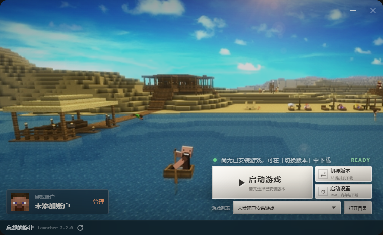
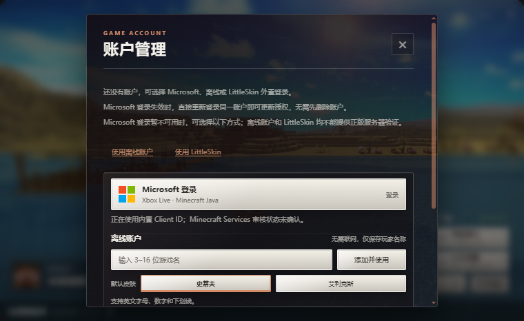

<div align="center">
  

# Melody of Oblivion Launcher

**A modern, independent remake of the classic Chinese Minecraft: Java Edition launcher “忘却的旋律”.**

[English](README.en.md) · [简体中文](README.md)

[Download](https://melodyoblivion.xyz/#download) · [GitHub Releases](https://github.com/leiming2333/The-Melody-of-Oblivion-Remake/releases)

[](https://www.gnu.org/licenses/gpl-3.0)
[](https://nodejs.org/)
[](https://www.electronjs.org/)
[](https://www.minecraft.net/)
[](#platform-coverage-and-prerequisites)
[](https://github.com/leiming2333/The-Melody-of-Oblivion-Remake)
</div>

> [!IMPORTANT]
> This unofficial, independent remake has AI-written code and documentation. It is not affiliated with or endorsed by Mojang Studios, Microsoft, or the original launcher's author. Errors, omissions, and compatibility issues may remain; back up your worlds, mods, and configuration before use. When reporting a problem, include the version, reproduction steps, and redacted logs. Do not share account files, passwords, or tokens.

## About this project

Melody of Oblivion Launcher is an Electron-based Minecraft: Java Edition launcher built from scratch. It keeps the quiet, compact character associated with the old launcher while replacing its internals with a modern download, account, Java-runtime, mod-loader, and launch pipeline.

This is an independent tribute. It is **not** an official update, a continuation of the original source code, or a project endorsed by the original developer, Mojang Studios, or Microsoft.

## The name and its history

“忘却的旋律” is remembered as one of the early third-party Minecraft launchers widely used in the Chinese community. Public accounts commonly describe it as an Easy Language application that became popular around 2012 for its small size, simple interface, background customization, and convenient game setup. Version `5.31` is widely reported as its final release, with maintenance ending in 2014.

The surviving public record is incomplete and sometimes contradictory—for example, the same encyclopedia entry mentions both 2009 and 2012 as origin dates. This README therefore treats “around 2012”, version `5.31`, and 2014 as community-reported history rather than verified primary-source facts.

The current repository starts a new implementation; its version numbers and code lineage are unrelated to the historical launcher.

## What is implemented

- **Startup preparation** — check core static resources before opening home. Settings, accounts, local profiles, and Java load independently in the background; a failed or stalled module does not block home. Core-resource failures provide details and retry, while other errors appear in their own modules.
- **Module isolation** — downloads, loaders, Java, accounts, settings, updates, and logs run in separate background processes. Forge installation uses a dedicated process and waits for Java child cleanup on cancellation or shutdown. Shared game files retain write exclusion; see [module isolation](docs/module-isolation.md) (Chinese).
- **Game versions** — browse Mojang's manifest and filter releases, snapshots, installed versions, or older Alpha/Beta versions. Search ranks exact and same-series matches first, with latest-version and repair labels. Download Vanilla, verify files, and move removable profiles to the recycle bin. Background refresh preserves the selection, and installation locks its target.
- **Mod loaders** — discover and install Fabric, Forge, NeoForge, and Quilt through a shared workflow. New Fabric installations can include a selected compatible Fabric API version or skip it. Existing ordinary Fabric profiles offer “Add Fabric API” without reinstalling the loader; this entry does not target modpack instances. API files are checksum-verified and placed in the profile's active `mods` directory. Conflicting files are reported without overwriting existing mods.
- **Resilient downloads** — choose between Mojang-hosted endpoints and BMCLAPI, probe sources in automatic mode, use configurable task concurrency, split large files with HTTP Range requests, verify SHA-1 metadata, cancel active work, and retry alternate sources. The task panel shows size, file counts, speed, and remaining time, with separate download, verification, installation, and missing-file states. Progress and action buttons remain visible in small windows.
- **Accounts** — use Microsoft device-code sign-in, offline profiles, or LittleSkin Yggdrasil; refresh online credentials before launch and keep tokens out of the renderer process. Optional LittleSkin skin lookup failures do not discard a successful login.
- **Java management** — match the Java major version required by the selected game; scan system installations and managed runtimes. The home launch button previews Java readiness for the selected version, and a failed launch caused by a missing runtime offers a one-click download that retries automatically. Java 8, 16, 17, 21, or 25 can also be downloaded next to the Java path setting, with progress and cancellation. Downloads prefer Azul JRE and fall back to Adoptium, use parallel transfers, and verify SHA-256.
- **Launch core** — resolve inherited version metadata, apply platform rules, assemble arguments and classpaths, extract native libraries safely, launch the Java process, and report its status. LittleSkin accounts automatically provision a SHA-256-verified authlib-injector.
- **Modpacks** — inspect and install Modrinth `.mrpack` and CurseForge `.zip` archives into separate instances with overrides, Fabric, Forge, NeoForge, and Quilt. A single confirmation shows the game, loader, and file counts; optional files are unchecked by default. Only remote resolution or download failures allow optional files to be skipped with a warning. Disk, permission, and security errors stop installation; required-file failures support retry. Restricted CurseForge files can be downloaded from their official pages, selected locally, and verified against trusted hashes before installation continues.
- **Launcher updates** — checks GitHub Releases on startup with a three-level policy (auto-download / notify only / never); system notifications announce new versions and ready updates, and settings show release notes. Small parallel probes choose among Blob, GitHub mirrors, and GitHub. Large packages use four concurrent ranges and retain completed ranges when changing sources during the same download; servers without Range support use a single stream. When one of the latest three stable releases is installed, a bsdiff + Zstandard delta patch is preferred: patches are read from the R2 mirror first with GitHub/mirror fallback, the installed file and patch are verified, the exact target bytes are reconstructed, and the full size and official SHA-256 are checked before installation. Missing, stale, corrupt, or mismatched patches fall back to the complete segmented package; macOS retains one verified official ZIP as its patch base. Slow-speed detection adapts to measured throughput. Size or SHA-256 mismatches discard completed ranges and try another source; installation requires successful verification. Legacy boolean update settings migrate automatically. See [delta updates](docs/patch-updates.md).
- **Desktop UI** — a compact fixed-size frameless Electron window with version, account, download, launch, and settings flows. Reopen background tasks from home; retry failures or copy redacted details from the problem dialog. Closing a dialog keeps the task running. Cancel stops it and becomes unavailable during final commit.

### Download source coverage

- **BMCLAPI** — version manifest, version JSON, client, asset index, asset objects, libraries, and Forge / NeoForge installers, always with the official Mojang URL retained as a fallback.
- **Not via BMCLAPI** — logging configuration (`piston-data.mojang.com/v1/objects`) and per-game Quilt metadata / libraries. BMCLAPI does not expose these endpoints, so the launcher uses the official addresses directly (libraries still keep the aggregate mirror as a last resort) instead of sending requests that are guaranteed to fail.
- **Java runtimes** — supplied by Azul and Adoptium and are outside BMCLAPI's mirror scope.

The automated test suite covers accounts, authentication, downloads, Java selection, launching, loaders, modpacks, settings, local version management, and launcher updates.

## Actual interface

These screenshots were captured from the `1.6.5` Electron source, with no accounts added or games installed. The current source interface may differ.





The website does not embed launcher screenshots; the captures above appear in this README only. Its download section offers system and architecture selection. The primary button completes Cloudflare Turnstile verification, then downloads through a separate signed Worker using 1 MiB parts and four concurrent requests, with speed, progress, cancellation, and fixed upstream fallbacks. Files reach the browser's save flow only after size and official SHA-256 verification. Cancellation or closing the page discards in-memory parts. GitHub original and cloud-download links remain public, outside this downloader. Release notes open by default and show only the latest version. SHA-256 values are not displayed; launcher updates also verify files before installation. The verified button stays unavailable until its configuration and matching deployments are complete.

## Platform coverage and prerequisites

- **Platforms**: public builds with SHA-256 checksums cover Windows x64 / ia32 / ARM64, Linux x64 / ARM64 / ARMv7, and macOS x64 / ARM64. Every target except Linux ARMv7 runs startup and upgrade acceptance on its own native runner, and a failure blocks the release. ARMv7 is built and checksum-verified only: GitHub hosts no 32-bit ARM runner, and an AppImage runtime cannot execute under QEMU user mode, so that package has no startup acceptance yet.
- **Update replacement**: downloaded updates install only after choosing “Restart and install.” Windows preserves the current EXE name. macOS uses system `ditto` to validate and replace the `.app`, with a manual ZIP fallback for unwritable directories, read-only media, or App Translocation. Linux replaces the AppImage. The old app exits only after a helper handshake. Health confirmation runs in the background after the new window is shown, the preload bridge and local interface load, core resources pass validation, and home becomes ready. Settings, accounts, and profile scans load independently. Unconfirmed updates retain their backup, with retry or keep-current actions according to the transaction state. The UI no longer offers restoration of the previous version.
- **Update records and cleanup**: records are isolated by installation path. A healthy update retains one previous-version backup and cleans only older files owned by that record. Untracked Windows EXEs and `.old` files can be selected manually in settings and moved to the recycle bin. Cleanup excludes game data.
- **LittleSkin authentication**: Yggdrasil works only when client and server use the same authentication service. A LittleSkin account does not replace a premium account and never grants access to premium-only servers. See the [LittleSkin manual](https://manual.littleskin.cn/yggdrasil/).
- **CurseForge metadata**: installation depends on file metadata from CurseTools or, when configured, `CURSEFORGE_API_KEY`. Transient lookup failures are retried, resolved metadata is stored with the recovery session so restarts skip the requery, and a local file is never substituted when the trusted hash is missing. Removed files still have to be fetched from the pack page.
- **Loader compatibility**: Fabric, Forge, NeoForge, and Quilt modpacks are supported, and loader versions are validated against their official metadata before installation. Whether a pack actually runs still depends on the game version and its mods.
- **Manual-file recovery sessions**: sessions are persisted per game directory and restored after a restart or after switching back to that directory. Once a session waits for files, the launcher keeps a verified copy of the archive in `launcher-cache`, so moving, renaming, or deleting the original no longer discards it; the copy is removed when the session completes or is abandoned. Only a changed archive requires selecting the pack again.

## Requirements

- Windows 10/11, macOS, or Linux, with a download matching the device architecture
- Node.js `26.10.0` and npm `11.13.0` for source development and builds
- The Vercel website uses Node.js `24.x`. `engines.node` supports both environments; `.node-version` and the build preflight still require `26.10.0` for launcher builds.
- An internet connection for metadata, game files, authentication, and managed Java downloads
- A legally owned Minecraft: Java Edition account for authenticated online play

## Run from source

The Windows single-file portable EXE requires no installation. Artifact names omit the version; application metadata and release tags retain it. The first run extracts into a content-fingerprinted directory under `Melody/runtime/` beside the EXE and subsequent runs reuse it. A shared mutex coordinates extraction, launch leases and cleanup. After startup preparation succeeds and home is ready, background cleanup keeps the current runtime, one recent previous runtime, and any active runtimes; it removes other unused builds and extraction residue older than one day. Unwritable adjacent directories fall back to `%LOCALAPPDATA%/MelodyOfOblivion/runtime`. Accounts and settings remain in the existing user data location. Legacy `启动器运行文件` directories are not migrated or deleted automatically; remove them manually after all older launchers are closed. Published builds do not require Node.js.

```powershell
npm ci
npm run dev
```

System directory mode uses the operating system's Minecraft application-data directory (`%APPDATA%\.minecraft` on Windows). Local mode uses `.minecraft` beside the portable EXE or source checkout; runtime cache locations do not change it. Modpack instances are created below the selected `.minecraft/melody-instances`.

The window first shows a preparation page, checking that required interface, preload, and core module resources exist, are nonempty, and are readable. Home opens as soon as core checks pass. Optional resources, settings, accounts, and profile scans report errors within their own modules. Windows portable EXE extraction happens before Electron starts, so the preparation page appears after extraction.

Settings and account modules prepare their own configuration and backups on first use. Logs, game directories, and caches are created by the modules that need them. Existing configuration is preserved; missing or damaged primary files are restored from valid backups when available. Unrecoverable damage is retained and reported by the affected module. Failed settings reads do not overwrite saved configuration with defaults. Missing core resources require a complete launcher download; an unwritable game directory can be changed in settings. Preparation does not download Minecraft or Java, or verify all installed game files.

Java detection runs in the background after home is ready, using saved settings. Settings and game modules keep separate probe caches, with a distinct cache file per game directory to prevent concurrent writes. Runtime-file changes invalidate cached results, and manual redetection bypasses the cache. Missing Java produces a nonmodal hint on the launch button instead of a blocking dialog. The local version list resolves each profile's Java requirement through its inheritance chain, so home can preview readiness before launching.

`logs/startup-latest.json` records the most recent startup stages: main-process entry, Electron readiness, window display, preparation-page paint, settings / accounts / local-profile loading, home readiness (`core-ready`), and background Java detection. Portable EXE extraction before Electron starts is not measured.

Background module processes start on demand and are reused within the current game directory. Switching directories creates fresh services. Profile scans, Java detection, and loader installation run separately. A crashed module restarts on its next call; transient state such as sign-in sessions must be recreated. Active downloads still prevent directory switching. Extracted native libraries are cached by archive content and exclusion rules under `.minecraft/launcher-cache/native-archives`, with file verification on reuse and regeneration after changes or corruption. Each game uses separate copies; exiting a game removes its copies while preserving shared cache generations, which can be manually cleared after games close.

## Development commands

| Command | Purpose |
| --- | --- |
| `npm run dev` | Start the Electron app in development mode |
| `npm run check` | Syntax-check the main, preload, and renderer JavaScript |
| `npm test` | Run the Node.js test suite |
| `npm run smoke` | Run Electron with fresh temporary user-data and game directories; confirm preparation, readable configuration, and usable home controls, then exit and clean up |
| `npm run verify:toolchain` | Verify pinned Node, npm, Electron, and electron-builder versions |
| `npm run build -- --target windows-x64` | Build one target through the shared entry point without publishing |
| `npm run build:win` | Build Windows portable EXE with a persistent runtime |
| `npm run build:linux` | Build Linux AppImage |
| `npm run build:mac` | Build macOS zip packages |

See [CI and release validation](docs/ci-release-validation.md) (in Chinese) for checks, release gates, and platform startup coverage.

## Development and contributions

Issues and pull requests for code, documentation, and translations are welcome.

- [Development guide](docs/development.md) (Chinese): setup, code entry points, example tasks, and checks.
- [Development and regression cases](docs/development-cases.md) (Chinese): steps, expected results, and related automated tests.
- [Module isolation](docs/module-isolation.md) (Chinese): process and UI boundaries, recovery, cancellation, and shared-file constraints.
- [Contributing](CONTRIBUTING.md): fork, branch, PR, and review instructions, with a short English guide.
- [Code of Conduct](CODE_OF_CONDUCT.md#english): community standards, private reporting, and enforcement.
- [Security Policy](SECURITY.md#english): supported versions, vulnerability reporting, and coordinated disclosure.

Bug and feature forms and a PR template help capture reproducible details. Existing CI runs checks and package validation according to the files changed.

## Repository layout

```text
src/
├── main/                 Main-process wiring and background implementations
│   ├── accounts/         Microsoft, offline, and LittleSkin accounts
│   ├── minecraft/        Downloads, Java, loaders, launch, and modpacks
│   ├── settings/         Persistent launcher settings
│   ├── updater/          Launcher updates
│   ├── worker-modules/   Independent background entry points
│   ├── module-process.js Process management and RPC
│   └── module-worker.js  Calls, progress, and cancellation protocol
├── preload/              Sandboxed renderer bridge
└── renderer/             Launcher interface
test/                     Node.js tests
assets/                   Shared artwork
index.html                Project landing page
site.js                   Landing-page translations and behavior
styles.css                Landing-page styles
```

The repository root contains the website, while `src/renderer` contains the Electron launcher. The website does not embed launcher captures; `assets/launcher-screenshot.png` and `assets/launcher-accounts.png` appear in this README only, so recapture them when the launcher interface changes.

Public Cloudflare R2 objects and manifests remain available to launcher updates and the signed website-download gateway. The default verification endpoint is the separate `verified-downloads.melodyoblivion.xyz`, not the existing public `downloads` hostname. GitHub determines release versions, sizes, and SHA-256 values; manifests change only after all eight packages have been uploaded and read back for verification. The primary website button restores human verification and concurrent parts, while GitHub originals and cloud downloads remain public. See [object-storage downloads](docs/object-storage-downloads.md) and [Cloudflare download gateway](cloudflare/README.md) for configuration, deployment, backfilling, and performance testing.

## Security notes

- Electron runs the renderer with context isolation, sandboxing, and Node.js integration disabled.
- LittleSkin access and client tokens are removed from renderer-facing account objects.
- Online-account tokens are encrypted at rest with Electron's `safeStorage`. Unavailable secure storage or an unprotected Linux backend such as `basic_text` blocks saving and reading online credentials. Offline accounts remain usable.
- Only one launcher can run per user-data directory; opening it again focuses the existing window. Account and settings changes also share a queue across store objects targeting the same file.
- Download destinations, modpack paths, archive extraction, and remote mod URLs are validated to reduce path-traversal and unsafe-URL risks.
- SHA-1 checks detect accidental corruption when upstream metadata provides a hash; SHA-1 should not be treated as a modern authenticity guarantee.

Report vulnerabilities privately to [leiming2333@qq.com](mailto:leiming2333@qq.com) under the [Security Policy](SECURITY.md#english). Do not include account files, access tokens, refresh tokens, device codes, or personal Minecraft data.

## Diagnostics and installation retries

Java stdout and stderr are saved under `launcher-cache/game-logs` in the game root. Each log is limited to 2 MiB, with five recent logs retained by default; logs for running games remain available. Known account tokens and common credential fields are redacted, and full launch commands are not recorded. Crash messages include the log path. Check usernames, server addresses, and other personal details before sharing a log.

Modpack previews and installation share archive safety checks. Hash-verified downloads are cached under `launcher-cache/modpack-files` in the game root and survive failed or cancelled installations. Every reuse verifies the file again; files without trusted hashes are not cached. Local imports are copied to a temporary file before verification; renamed files are accepted when their hashes match. All downloads finish or stop and partial instances are removed before waiting for missing files.

Internal staging directories are hidden from the instance list. Startup scans and later installations reclaim only inactive crash residue with a valid launcher ownership marker and a safe path, retaining verified downloads. Failed cleanup can be retried later. To reclaim cache space, remove the cache directory after closing games and stopping installations.

Builds use a pinned toolchain, a committed lockfile, one platform target definition, and clean isolated output directories. Manually dispatched CI produces eight packages, checksum sidecars, `SHA256SUMS`, a build manifest, and seven native startup/upgrade reports without public publication. Version tags publish only after validation. Repeatability means fixed inputs and traceable outputs, not identical bytes. See [release validation](docs/ci-release-validation.md).

## Historical references

- [Baidu Baike: 忘却的旋律 (Minecraft Java Edition launcher)](https://baike.baidu.com/item/%E5%BF%98%E5%8D%B4%E7%9A%84%E6%97%8B%E5%BE%8B/16496487) — a secondary community-edited summary; consulted for the commonly reported 2012/2014 timeline and final version.
- [Minecraft: Java Edition is moving house](https://www.minecraft.net/en-us/article/java-edition-moving-house) — Mojang's announcement of the move from Mojang accounts to Microsoft accounts.

These links document historical context; they do not imply endorsement of this remake. Avoid downloading old launcher binaries from unverified mirrors.

## License and trademarks

The project is distributed under the [GNU General Public License v3.0](LICENSE). Third-party names, trademarks, and assets remain subject to their respective owners' terms.

Minecraft is a trademark of Microsoft. This project is unofficial and is not affiliated with or endorsed by Microsoft or Mojang Studios. The “忘却的旋律” name is used here as a reference and tribute to the historical launcher; no ownership of the original project is claimed.
