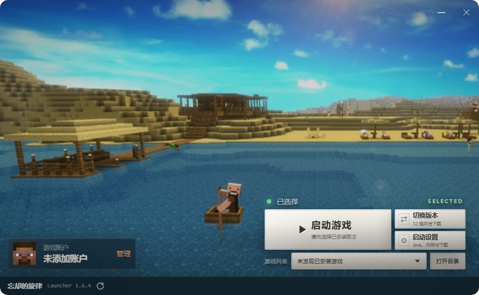
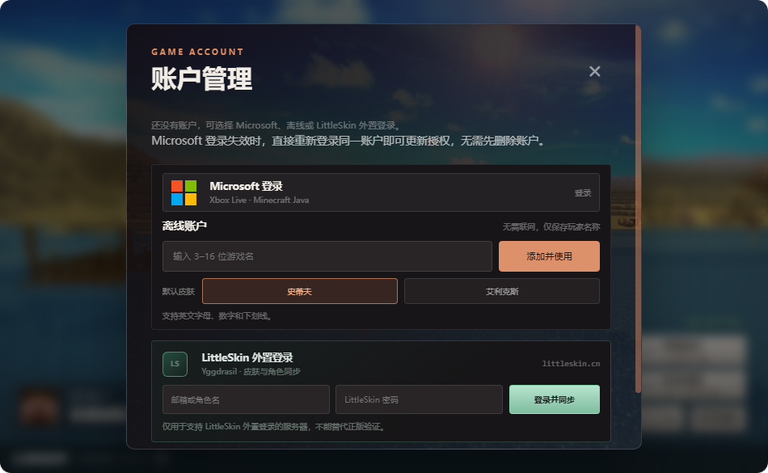

<div align="center">
  

# 忘却的旋律启动器

**经典国产 Minecraft Java 版启动器“忘却的旋律”的现代独立重制版。**

[English](README.en.md) · 简体中文

[](https://www.gnu.org/licenses/agpl-3.0)
[](https://nodejs.org/)
[](https://www.electronjs.org/)
[](https://www.minecraft.net/)
[](#平台支持与使用前提)
[](https://github.com/leiming2333/The-Melody-of-Oblivion-Remake)
</div>

> [!IMPORTANT]
> 当前源码版本为 `1.7.1`，支持 Microsoft、离线和 LittleSkin 登录，默认壁纸为「沙漠湖泊」。安装包可从[网站](https://the-melody-of-o-r.ccwu.cc/#download)或 GitHub Releases 下载，版本以 Release 页面为准。本地修改不会自动更新已发布内容：启动器源码需重新构建，官网需重新部署。测试前请先备份 Minecraft 数据。

## 项目简介

忘却的旋律启动器是一款从零开发的 Electron Minecraft Java 版启动器。它保留了旧版启动器安静、紧凑的气质，并使用现代的下载、账户、Java 运行时、模组加载器和游戏启动流程重写了内部实现。

本项目是一份独立致敬作品，并非原项目的官方更新或延续，也未使用原版源代码。本项目与原作者、Mojang Studios 及 Microsoft 均无隶属或认可关系。

## 名称与历史

“忘却的旋律”是国内 Minecraft 社区早期广泛使用的第三方启动器之一。现存公开资料通常将其描述为一款易语言程序，约在 2012 年流行，因体积小、界面简单、可更换背景及游戏配置方便而为人熟知。公开资料普遍称 `5.31` 为最终版本，并称项目于 2014 年停止维护。

现存资料并不完整，部分说法也互相矛盾，例如同一个百科页面同时提到了 2009 年和 2012 年。因此，本文将“约 2012 年”、最终版本 `5.31` 以及 2014 年停止维护视为社区流传的信息，而非经一手资料验证的事实。

当前仓库是全新的实现，其版本号与代码沿革均与历史启动器无关。

## 已实现功能

- **游戏版本**：浏览 Mojang 版本清单、识别本地安装、下载原版游戏、验证所需文件，并将可移除的配置移动到回收站。
- **模组加载器**：通过统一流程查询并安装 Fabric、Forge、NeoForge 与 Quilt。
- **可靠下载**：在 Mojang 官方源与 BMCLAPI 之间选择；自动模式会测速；支持任务并发、大文件 HTTP Range 分段、SHA-1 校验、取消下载及失败后切换来源重试。
- **账户系统**：支持离线账户、Microsoft 设备代码登录及 LittleSkin Yggdrasil；可同步皮肤头像、启动前刷新在线凭据，并阻止令牌进入渲染进程。
- **Java 管理**：匹配游戏所需的 Java 主版本，检测系统安装与启动器托管环境。在 Java 路径设置旁手动下载 Java 8、16、17、21 或 25，支持进度与取消；优先 Azul JRE，失败后切换 Adoptium，使用并行下载与 SHA-256 校验。启动时缺少所需 Java 会打开设置，不再自动下载。
- **启动核心**：处理版本继承、平台规则、参数与类路径、本地库安全解压、Java 进程启动及状态报告。LittleSkin 账户会自动准备经过 SHA-256 校验的 authlib-injector。
- **整合包**：检查并安装 Modrinth `.mrpack` 与 CurseForge `.zip`，使用独立实例目录并支持 overrides、Fabric、Forge、NeoForge 与 Quilt。导入确认显示游戏、加载器和文件数，可选文件默认不安装；可选文件的远端解析或下载失败仅警告，必需文件失败可重试；磁盘、权限或安全检查错误会中止安装。CurseForge 受限文件可从官方页面下载后选择本地文件，通过可信摘要校验再继续安装。
- **启动器更新**：启动时检测 GitHub Releases 新版本；提供三档更新策略（自动下载 / 仅提示 / 从不检查），发现新版本与更新就绪时发送系统通知，设置页可查看 Release 更新日志；更新包下载支持 GitHub 镜像多源自动切换与低速检测，完成后经 SHA-256 校验再安装。旧版布尔更新设置会自动迁移为新策略。
- **桌面界面**：紧凑的固定尺寸无边框 Electron 窗口，覆盖版本、账户、下载、启动及设置流程。首页可重新打开后台任务，问题对话框提供重试和复制脱敏详情；关闭弹窗继续任务，取消按钮停止任务，最终提交期间禁用取消。

自动化测试覆盖账户、身份验证、下载、Java 选择、游戏启动、加载器、整合包、设置、本地版本管理及启动器更新等领域。

## 实际界面

以下截图来自当前 `1.6.5` 源码运行的 Electron 启动器，截图时尚未添加账户或安装游戏。





官网首屏使用上面的主界面截图，账户介绍使用账户管理截图，背景也采用沙漠湖泊场景。下载区可选择系统、架构和下载来源。版本更新公告单独显示，默认展开，只展示最新一个版本。官网不展示安装包的 SHA-256 校验值，启动器安装更新前仍会校验 SHA-256。

## 平台支持与使用前提

- **平台覆盖**：Windows x64 / ia32 / ARM64、Linux x64 / ARM64 / ARMv7、macOS x64 / ARM64 均提供公开构建与 SHA-256 校验。除 Linux ARMv7 外，每个目标都由对应的原生 runner 执行启动与升级验收，未通过不发布。ARMv7 目前只做构建与文件校验：GitHub 不提供 32 位 ARM runner，且 AppImage 运行时在 QEMU 用户态下无法执行，因此该产物尚未完成启动验收。
- **更新替换**：更新下载完成后点击「重启并安装」才替换程序。Windows 保留当前 EXE 名称；macOS 使用系统 `ditto` 校验并替换 `.app`，在只读介质、目录不可写或 App Translocation 环境下提供 ZIP 手动替换入口；Linux 替换 AppImage。辅助进程握手成功后才退出旧程序，新版窗口、预加载桥接和本地界面加载完成才确认更新；未确认时保留备份并提供重试或恢复入口。
- **更新记录与清理**：每个安装路径独立记录更新状态，确认成功后保留最近一份回退版本，只清理该记录拥有的旧文件。无记录的 Windows 历史 EXE 和 `.old` 可在设置中勾选后移入回收站。游戏数据不在更新清理范围内。
- **LittleSkin 验证服务**：Yggdrasil 仅在客户端和服务端使用相同验证服务时生效；LittleSkin 账户不能替代正版账户，也不会获得进入正版验证服务器的权限。参见 [LittleSkin 用户使用手册](https://manual.littleskin.cn/yggdrasil/)。
- **CurseForge 元数据**：安装依赖 CurseTools 提供的文件元数据，或配置 `CURSEFORGE_API_KEY`。临时查询失败会自动重试，已解析的元数据随补齐会话保存，重启后无需重新查询；缺少可信摘要时不会用本地文件顶替校验，已下架文件仍需从整合包发布页获取。
- **加载器兼容性**：支持 Fabric、Forge、NeoForge 与 Quilt 整合包，加载器版本安装前会向各自官方元数据校验；整合包能否正常运行最终取决于游戏版本与其中具体 Mod。
- **整合包补齐会话**：按游戏目录持久化，重启或切换回原目录后会自动恢复。会话进入等待补齐状态时，启动器会在 `launcher-cache` 保留一份校验过的归档副本，原始归档被移动、重命名或删除后仍可继续，副本在会话完成或放弃后删除；原归档内容被改动时才要求重新选择整合包。

## 运行要求

- Windows 10/11、macOS 或 Linux，安装包架构需与设备匹配
- 源码开发与构建固定使用 Node.js `26.10.0`、npm `11.13.0`
- Vercel 网站使用 Node.js `24.x`。`engines.node` 兼容网站与启动器两个环境；启动器构建仍由 `.node-version` 和工具链检查固定为 `26.10.0`。
- 用于元数据、游戏文件、账户验证及托管 Java 下载的网络连接
- 进行正版在线游戏时，需要合法拥有的 Minecraft Java 版账户

## 从源码运行

Windows 提供单文件便携 EXE，无需安装，打包文件名不带版本号（版本仍保留在程序及 Release 标签中）。首次运行将 Electron 和程序文件释放到 EXE 旁的 `Melody/runtime/` 子目录，后续复用已完成的运行目录。各构建按内容指纹独立存放，并发释放与清理由互斥锁协调；正在运行的版本不会被清理。窗口准备完成后在后台保留当前版本和最近一个旧版本，清理其余未使用的运行目录及超过一天的解压残留。若 EXE 旁无法写入，回退到 `%LOCALAPPDATA%\MelodyOfOblivion\runtime`。账号和设置仍保存在原用户数据目录；旧版的 `启动器运行文件` 不会自动迁移或删除，关闭所有旧版启动器后可手动删除。关闭所有启动器后可以删除运行目录，下次启动会重新释放。

运行发布包无需安装 Node.js，Java 仅用于运行 Minecraft。

```powershell
npm ci
npm run dev
```

Microsoft 登录使用内置的公开 Azure 应用 ID。如需使用自己的应用注册，可在启动或构建前设置 `MELODY_MICROSOFT_CLIENT_ID`。

系统目录模式使用操作系统默认的 Minecraft 应用数据目录（Windows 为 `%APPDATA%\.minecraft`）。本地目录模式使用启动器 EXE 旁的 `.minecraft`，不会因运行文件子目录或缓存回退而改变。整合包实例存放在所选 `.minecraft\melody-instances` 下。

Java 检测结果保存在用户数据目录的 `java-cache.json`，可执行文件或运行时文件变化时重新探测，设置中的「重新检测」会绕过缓存。首页先绘制，再后台读取账户、设置、游戏版本与检测 Java；缺少 Java 时仅提示，不自动弹出阻塞对话框。

下载、加载器、整合包、Java 下载和游戏启动服务按需加载，并在当前游戏目录内复用；切换目录后创建新的服务。首页读取本地版本和 Java 检测使用轻量模块，不会提前加载下载或启动核心。游戏原生库按归档内容与排除规则缓存在 `.minecraft\launcher-cache\native-archives`，每次复用会校验解压文件；归档变化或缓存损坏时重新解压。每个游戏进程使用独立副本，退出只清理该进程的副本，不删除共享缓存。缓存保留旧代，关闭游戏后可手动清理。

启动耗时记录在用户数据目录的 `logs\startup-latest.json`，包含主进程入口、Electron 就绪、窗口显示、界面绘制和后台初始化阶段。记录从主进程开始执行时计时，无法测量便携 EXE 在启动 Electron 前的解压耗时；文件只保留最近一次记录，不包含账户凭据。

## 开发命令

| 命令 | 用途 |
| --- | --- |
| `npm run dev` | 以开发模式启动 Electron 应用 |
| `npm run check` | 检查主进程、预加载脚本与渲染脚本语法 |
| `npm test` | 运行 Node.js 自动化测试 |
| `npm run smoke` | 使用临时用户数据加载 Electron 窗口并退出 |
| `npm run verify:toolchain` | 验证固定 Node、npm、Electron 和 electron-builder 版本 |
| `npm run build -- --target windows-x64` | 使用统一入口构建单一目标，默认不发布 |
| `npm run build:win` | 构建 Windows 持久运行目录便携 EXE |
| `npm run build:linux` | 构建 Linux AppImage |
| `npm run build:mac` | 构建 macOS zip 包 |

持续检查、发布门槛与各平台启动验证范围见[持续检查与发布验证](docs/ci-release-validation.md)。

## 仓库结构

```text
src/
├── main/                 Electron 主进程
│   ├── accounts/         离线、Microsoft 与 LittleSkin 账户
│   ├── minecraft/        下载、Java、加载器、启动与整合包
│   └── settings/         持久化设置
├── preload/              沙箱化的渲染进程桥接层
└── renderer/             启动器界面
test/                     自动化测试
assets/                   共用美术资源
index.html                项目落地页
site.js                   落地页翻译与交互逻辑
styles.css                落地页样式
```

官网位于仓库根目录，Electron 启动器界面位于 `src/renderer`。官网使用 `assets/launcher-screenshot.png` 和 `assets/launcher-accounts.png` 两张真实截图展示启动器；界面变化后需重新采集截图。

## 安全说明

- Electron 渲染进程启用了上下文隔离和沙箱，并关闭 Node.js 集成。
- Microsoft 与 LittleSkin 的访问令牌、刷新令牌和客户端令牌不会出现在提供给渲染进程的账户对象中。
- 在线账户令牌使用 Electron `safeStorage` 加密保存。如果安全存储不可用，或 Linux 使用 `basic_text` 等无保护后端，启动器会拒绝保存或读取在线凭据。离线账户仍可使用。
- 启动器按用户数据目录限制多开；再次打开会聚焦已有窗口。同一文件的账户和设置修改也会在不同存储对象之间排队，避免互相覆盖。
- Microsoft 登录使用公开 OAuth 应用 ID，构建时可用 `MELODY_MICROSOFT_CLIENT_ID` 覆盖。仓库不包含客户端密钥；公开 Electron 构建无法对内嵌 Client ID 保密。
- 下载目标、整合包路径、压缩包解压位置和远程模组 URL 均会经过验证，以降低路径穿越及不安全 URL 的风险。
- 上游元数据提供哈希时，SHA-1 校验可发现意外损坏，但不应将 SHA-1 视为现代的真实性保证。

提交安全问题时，请勿包含账户文件、访问令牌、刷新令牌、设备代码或个人 Minecraft 数据。

## 诊断与安装重试

Java 的标准输出和错误输出保存到游戏根目录的 `launcher-cache/game-logs`，单个日志最多 2 MiB，默认保留最近 5 次；正在运行游戏的日志不会被清理。日志隐藏已知账户令牌和常见凭据字段，不记录完整启动命令。异常退出提示提供日志路径；分享前仍应检查日志中的用户名、服务器地址等个人信息。

整合包预览和安装共用归档安全校验。经过摘要校验的下载缓存在游戏根目录的 `launcher-cache/modpack-files`，安装失败或取消后可供重试复用；每次复用都会重新校验。没有可信摘要的文件不进入此缓存。手动补齐先复制至临时文件再校验，文件名不同但摘要匹配的文件也可使用。等待补齐前会结束下载并清理半成品。

实例列表隐藏内部暂存目录。下次启动扫描或安装时仅回收带有本启动器归属标记、路径安全且非活跃的崩溃残留，保留已校验缓存；清理失败可在下次重试。需要释放缓存空间时，可在关闭游戏、停止安装后删除缓存目录。

构建使用固定工具链、锁文件与单一平台目标定义，产物写入独立的干净目录。手动 CI 生成八类安装包、校验侧文件、`SHA256SUMS`、构建清单和七类原生启动/升级报告，不公开发布；版本标签验证通过后才发布。可重复构建在此指输入固定且产物可追溯，不承诺字节完全一致。详见[发布验证说明](docs/ci-release-validation.md)。

## 历史资料

- [百度百科：忘却的旋律（《Minecraft》游戏启动器）](https://baike.baidu.com/item/%E5%BF%98%E5%8D%B4%E7%9A%84%E6%97%8B%E5%BE%8B/16496487)：社区编辑的二手资料，用于参考常见的 2012/2014 时间线与最终版本说法。
- [Minecraft: Java Edition is moving house](https://www.minecraft.net/en-us/article/java-edition-moving-house)：Mojang 关于 Mojang 账户迁移至 Microsoft 账户的公告。

这些链接仅用于说明历史背景，并不代表相关方认可本重制项目。请勿从未经验证的镜像下载旧启动器程序。

## 许可证与商标

本项目采用 [GNU Affero General Public License v3.0](LICENSE) 许可。第三方名称、商标及素材仍受各自权利人的条款约束。

Minecraft 是 Microsoft 的商标。本项目为非官方项目，与 Microsoft 或 Mojang Studios 无隶属或认可关系。“忘却的旋律”名称仅用于指代和致敬历史启动器，本项目不主张拥有原项目。
